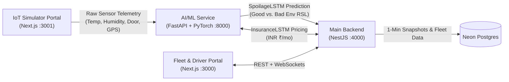

# ColdChain — Refrigerated Fleet Intelligence & Dual-LSTM Insurance Platform

A full-stack cold-chain logistics, IoT telemetry, and AI-driven dynamic insurance platform built with **Next.js 14**, **NestJS**, **FastAPI + PyTorch LSTM**, and **Neon Postgres**.

---

## System Architecture



### Monorepo Structure

| Folder | Stack | Port | Purpose |
| :--- | :--- | :--- | :--- |
| `frontend/` | Next.js 14, Tailwind, Leaflet, Three.js | `:3000` | Admin, Fleet Owner (Company), and Driver portals + PDF reports |
| `backend/` | NestJS 11, Socket.IO, Neon Serverless | `:4000` | Auth/RBAC, fleet & trip APIs, 1-minute Neon DB LSTM logging |
| `ai-ml/` | FastAPI, PyTorch, Pandas, Streamlit | `:8000` | Synthetic data generator, `SpoilageLSTM` & `InsuranceLSTM`, route simulator |
| `iot/` | Next.js 14 | `:3001` | Multi-device ESP32 sensor simulator & anomaly injection portal |

---

## Dual-LSTM AI/ML & 1-Minute Neon DB Pipeline

1. **Synthetic Dataset Generation & Training (`ai-ml/train_lstm.py`)**
   - Generates 2,400 time-series sensor sequences (`ai-ml/data/coldchain_sensor_data.csv`) across **good**, **moderate**, and **bad/excursion** environments (temperature spikes, door-open events, compressor failures) for 5 cargo profiles.
   - Generates 2,000 insurance underwriting sequences (`ai-ml/data/coldchain_insurance_data.csv`).
   - Trains two PyTorch LSTM models and saves weights to `ai-ml/artifacts/`:
     - `spoilage_lstm.pt` (`SpoilageLSTM`): Predicts `spoilage_risk`, `spoilage_risk_level`, `shelf_life_remaining_hours`, `quality_retention_pct`, and **Good vs. Bad Environment** remaining shelf-life (`good_env_rsl_hours`, `bad_env_rsl_hours`).
     - `insurance_lstm.pt` (`InsuranceLSTM`): Uses sensor/spoilage sequences, excursion counts, door events, and trip history anchored on the Admin-configured real base price (`₹/mo`) to compute dynamic monthly premiums (`₹/mo`), risk score (`0–100`), and risk tier.

2. **1-Minute Neon Postgres Persistence (`backend/src/iot/iot.service.ts`)**
   - Every **1 minute** (`SNAPSHOT_INTERVAL_MS = 60 * 1000`), active trucks persist both their `SpoilageLSTM` output and `InsuranceLSTM` pricing snapshot into `trip_telemetry_history` in Neon Postgres.

3. **Admin, Company & PDF Reporting (`frontend/`)**
   - **Admin (`/admin/insurance`, `/admin/trucks`)**: Set/edit real base insurance prices (`₹/mo`) per truck, trigger `InsuranceLSTM`, inspect 1-minute Neon DB logs, and export **All Companies & Trucks PDF**, **Per-Company PDF**, or **Per-Truck PDF** reports.
   - **Company / Owner (`/owner?tab=insurance`, `/owner/trucks/[id]`)**: View fleet insurance adjustments in `₹`, inspect 1-minute LSTM logs, and export **Company Fleet PDF** or **Per-Truck PDF** reports.

---

## Getting Started

### 1. Prerequisites
- **Node.js** 18+ and **npm**
- **Python** 3.10+
- A **Neon Postgres** database URL (configure `backend/.env` or `.env.local` using `backend/.env.example`)

### 2. Install Dependencies

```powershell
# Backend
cd backend
npm install

# Frontend
cd ../frontend
npm install

# IoT Simulator
cd ../iot
npm install

# AI/ML Service
cd ../ai-ml
pip install -r requirements.txt
```

### 3. Initialize Database & Train LSTM Models

```powershell
# Initialize Neon Postgres tables & demo seed data
cd backend
npm run db:init

# (Optional) Re-generate synthetic datasets and re-train PyTorch LSTM models
cd ../ai-ml
python train_lstm.py
```

### 4. Run All 4 Services

Run each in a separate terminal from the repository root (`e:\MyProject\coldChain`):

```powershell
# 1. AI/ML Service (port 8000)
npm run dev:aiml

# 2. Main Backend (port 4000)
npm run dev:backend

# 3. IoT Simulator & Hardware Portal (port 3001)
npm run dev:iot

# 4. Main Driver & Fleet App (port 3000)
npm run dev:frontend
```

---

## Demo Accounts

All seeded demo accounts use password `password123`:

| Role | Email | Portal |
| :--- | :--- | :--- |
| **Admin** | `admin@elitecold.com` | `/admin` |
| **Fleet Owner (Company)** | `owner1@elitecold.com` | `/owner` |
| **Driver (Truck User)** | `driver1@elitecold.com` | `/truck` |

---

## Key API Endpoints

### Backend (`http://localhost:4000`)
- `POST /api/auth/login`, `POST /api/auth/register`, `GET /api/auth/me`, `POST /api/auth/logout`
- `GET /api/admin/metrics`, `GET|POST /api/admin/owners`, `GET|POST|PATCH|DELETE /api/admin/trucks`, `GET /api/admin/lstm-logs`
- `GET|POST /api/owner/trucks`, `GET|POST /api/owner/drivers`, `PATCH /api/owner/trucks/:id/target-temp`, `GET /api/owner/lstm-logs`
- `GET /api/truck/my-truck`, `GET /api/truck/active-trip`, `POST /api/truck/start-trip`, `POST /api/truck/end-trip/:tripId`, `PATCH /api/truck/target-temp`, `GET /api/truck/telemetry`
- `POST /api/iot/ingest`, `GET /api/iot/telemetry/:truckId`, `GET /api/iot/history/:truckId`, `POST /api/iot/insurance/:truckId/recalculate`

### AI/ML Service (`http://localhost:8000`)
- `GET /health` — Service & LSTM model load status
- `POST /api/iot/process` — Runs `SpoilageLSTM` (good vs. bad env RSL) and forwards to backend ingest
- `POST /api/predict/insurance` — Runs `InsuranceLSTM` dynamic premium calculation (`₹/mo`)
- `GET /api/trucks/{truck_id}/telemetry` — Simulated truck telemetry enriched with `SpoilageLSTM`
- `WS /ws/telemetry/{truck_id}` — 10-second live WebSocket telemetry stream
