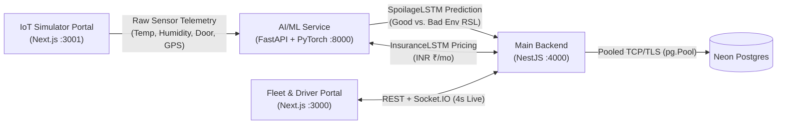

# ColdChain — Refrigerated Fleet Intelligence & Dual-LSTM Insurance Platform

A full-stack cold-chain logistics, IoT telemetry, and AI-driven dynamic insurance platform built with **Next.js 14**, **NestJS 11**, **FastAPI + PyTorch LSTM**, and **Neon Postgres**.

---

## System Architecture



### Monorepo Structure

| Folder | Stack | Port | Deployment | Purpose |
| :--- | :--- | :--- | :--- | :--- |
| `frontend/` | Next.js 14, Tailwind, Leaflet, Three.js | `:3000` | **Vercel / Netlify** | Enterprise landing page, 4,934-warehouse GIS map, 3D Sentinel X1 showcase, Admin, Company, and Driver portals |
| `backend/` | NestJS 11, Socket.IO, `pg.Pool` | `:4000` | **Render** | Auth/RBAC, fleet & 3-role trip dispatch, 1-minute Neon DB LSTM logging |
| `ai-ml/` | FastAPI, PyTorch, Pandas | `:8000` | **Render** | Synthetic data generator, `SpoilageLSTM` & `InsuranceLSTM`, route simulator |
| `iot/` | Next.js 14 | `:3001` | **Vercel / Netlify** | Multi-device ESP32 sensor simulator with auto-stream & anomaly injection |

---

## Key Capabilities

- **Enterprise Landing & Hardware Showcase (`http://localhost:3000/`)**:
  - Custom SVG favicon (`frontend/app/icon.svg`), animated `<TruckHero />`, **ColdChain Sentinel X1** product image + interactive 3D Three.js model, and an interactive Canvas-rendered map of **4,934** cold-storage warehouses across India (sourced from `GeoIndiaHandlerGis.ashx` → `frontend/public/data/warehouses.json`).
- **3-Role Trip Dispatch & Live Tracking**:
  - **Admin (`/admin/trips`)**, **Company / Owner (`/owner/trips`)**, and **Driver (`/truck` → `+ Assign Trip`)** can all assign trips (`Origin → Destination`, `Cargo Type`), start trips, stream live browser GPS, and view route navigation.
- **Dual-LSTM AI/ML & 1-Minute Neon DB Pipeline**:
  - `SpoilageLSTM` predicts `spoilage_risk`, `spoilage_risk_level`, `shelf_life_remaining_hours`, `quality_retention_pct`, and **Good vs. Bad Environment** remaining shelf-life.
  - `InsuranceLSTM` evaluates thermal excursions, door-seal events, and trip history anchored on Admin-configured base prices (`₹/mo`) to compute dynamic monthly premiums.
  - `IotService` persists 1-minute `SpoilageLSTM` + `InsuranceLSTM` snapshots to `trip_telemetry_history` in Neon Postgres and updates `iot_devices.last_seen` on every sensor ingest.
- **Real-Time 4-Second Telemetry Sync**:
  - Both Owner (`/owner/trucks/[id]`) and Driver (`/truck`) poll live telemetry every **4 seconds**, matching the IoT Simulator's auto-stream cadence.

---

## Local Development

### 1. Prerequisites
- **Node.js** 18+ and **npm**
- **Python** 3.10+
- A **Neon Postgres** database URL (configure `backend/.env` or `.env.local` using `backend/.env.example`)

### 2. Install Dependencies

```powershell
# Backend
cd backend
npm install

# Frontend
cd ../frontend
npm install

# IoT Simulator
cd ../iot
npm install

# AI/ML Service
cd ../ai-ml
pip install -r requirements.txt
```

### 3. Initialize Database & Train LSTM Models

```powershell
# Initialize Neon Postgres tables & demo seed data
cd backend
npm run db:init

# (Optional) Re-generate synthetic datasets and re-train PyTorch LSTM models
cd ../ai-ml
python train_lstm.py
```

### 4. Run All 4 Services

Run each in a separate terminal from the repository root (`e:\MyProject\coldChain`):

```powershell
# 1. AI/ML Service (port 8000)
npm run dev:aiml

# 2. Main Backend (port 4000)
npm run dev:backend

# 3. IoT Simulator & Hardware Portal (port 3001)
npm run dev:iot

# 4. Main Driver & Fleet App (port 3000)
npm run dev:frontend
```

---

## Production Deployment (Render + Vercel + Netlify)

Full step-by-step instructions and environment variable tables are in [`DEPLOYMENT.md`](./DEPLOYMENT.md):

- **Backends (`backend/` & `ai-ml/`) on Render**: Configured via [`render.yaml`](./render.yaml) Blueprint.
- **Frontends (`frontend/` & `iot/`) on Vercel**: Configured via [`frontend/vercel.json`](./frontend/vercel.json) and [`iot/vercel.json`](./iot/vercel.json).
- **Frontends (`frontend/` & `iot/`) on Netlify**: Configured via [`frontend/netlify.toml`](./frontend/netlify.toml) and [`iot/netlify.toml`](./iot/netlify.toml).

---

## Demo Accounts

All seeded demo accounts use password `password123`:

| Role | Email | Portal |
| :--- | :--- | :--- |
| **Admin** | `admin@elitecold.com` | `/admin` |
| **Fleet Owner (Company)** | `owner1@elitecold.com` | `/owner` |
| **Driver (Truck User)** | `driver1@elitecold.com` | `/truck` |

---

## Key API Endpoints

### Backend (`http://localhost:4000`)
- `POST /api/auth/login`, `GET /api/auth/me`, `POST /api/auth/logout`
- `GET /api/neon/health` — Database health check
- `GET /api/admin/metrics`, `GET|POST /api/admin/owners`, `GET|POST|PATCH|DELETE /api/admin/trucks`, `GET /api/admin/lstm-logs`
- `GET|POST /api/owner/trucks`, `GET|POST /api/owner/drivers`, `PATCH /api/owner/trucks/:id/target-temp`, `GET /api/owner/lstm-logs`
- `GET|POST /api/trips`, `GET /api/trips/resources`, `PATCH /api/trips/:id/reopen`
- `GET /api/truck/my-truck`, `GET /api/truck/assigned-trip`, `POST /api/truck/assign-trip`, `POST /api/truck/start-trip`, `PATCH /api/truck/trips/:tripId/complete`, `PATCH /api/truck/target-temp`, `GET /api/truck/telemetry`
- `POST /api/iot/devices/registry-sync`, `POST /api/iot/ingest`, `GET /api/iot/telemetry/:truckId`, `GET /api/iot/history/:truckId`, `POST /api/iot/insurance/:truckId/recalculate`

### AI/ML Service (`http://localhost:8000`)
- `GET /health` — Service & LSTM model load status
- `POST /api/iot/process` — Runs `SpoilageLSTM` (good vs. bad env RSL) and forwards to backend ingest
- `POST /api/predict/insurance` — Runs `InsuranceLSTM` dynamic premium calculation (`₹/mo`)
- `GET /api/trucks/{truck_id}/telemetry` — Simulated truck telemetry enriched with `SpoilageLSTM`
- `WS /ws/telemetry/{truck_id}` — 10-second live WebSocket telemetry stream
