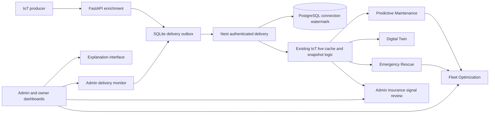

# ColdChain platform advancement

## Architecture

Fleet Optimization is documented separately in [FLEET_OPTIMIZATION.md](./FLEET_OPTIMIZATION.md). The platform continues to read the existing saved spoilage and insurance LSTM weights.

## Durable telemetry delivery

1. Apply migrations through `009_telemetry_delivery.sql` to the intended isolated or approved database. Start Nest with its existing ingest secret, an internal AI/ML base URL, and a distinct `TELEMETRY_MONITOR_TOKEN`. Set the same monitor token in FastAPI, together with its existing producer token and backend ingest secret.
2. Set `TELEMETRY_OUTBOX_PATH` in FastAPI to a SQLite filename in an existing, writable directory on a persistent local volume. Keep that file and its WAL out of Git. Start a single FastAPI worker and operate one active Nest live-projection writer for the fleet. The SQLite file supports leases and crash recovery across worker restarts. Live telemetry is still a process-local projection, so distributed read consistency across Nest replicas would require a shared live read model.
3. Raw observations must contain an authenticated producer identity, a device ID, a pairing, and a timezone-qualified observation timestamp. The gateway hashes the canonical device ID, uppercase pairing, and UTC instant at millisecond resolution. Admission stores the original envelope and prediction before replying. Repeated admission of a retained event returns the stored prediction. Late observations use a temporary spoilage sequence and cannot append to the live spoilage or insurance sequence. Missing raw GPS or speed is forwarded as unavailable in durable mode.
4. After all producers use the outbox, set `TELEMETRY_REQUIRE_DURABLE=true` on Nest to reject legacy external ingest. Leaving the outbox path empty preserves existing forwarding. Never deploy the durable-only switch before migrating producers.

SQLite uses transactions with write locking, indexed readiness, and a 20-second leased claim. The worker polls once per second while idle and limits each delivery request with connect and read timeouts. Transient failures retry up to 12 attempts with exponential backoff capped at 300 seconds and jitter. Nonretryable HTTP client errors enter the dead-letter queue. The queue has 5,000 rows and a 16 KiB combined stored-event ceiling. On pressure, it evicts old delivered rows first or returns HTTP 503 if no space is available. Terminal rows older than seven days are removed during admission. Recent dead letters and replay audit are bounded. Retry and restarts do not alter observation timestamps.

Nest retains one ordered watermark per pairing. It acknowledges duplicate, out-of-order, or expired events without advancing live state. Events more than two minutes old are expired. The watermark survives restart. A crash before setting the projection marker can retry a fresh event. The projection, which includes the existing in-process cache and asynchronously written snapshots, is not a distributed exactly-once transaction. Start producers with stable observation timestamps and implement their own retry for failure before FastAPI accepts the payload. The in-browser IoT simulator can still lose its synthetic sample before gateway admission.

| API | Access and response |
| --- | --- |
| `POST /api/iot/process` on FastAPI | Producer token. Existing prediction body and `X-Telemetry-Delivery: queued` when admitted durably. HTTP 503 means backpressure, with Retry-After. |
| `POST /api/iot/delivery/accept` on Nest | Ingest secret and event hash. Returns applied, duplicate, expired, or out-of-order acknowledgement. HTTP 429 when a pairing or writer is busy. |
| `GET /api/iot/delivery/status` | Live administrator role. Queue counts, age, retained outcome totals, dead-letter metadata, and replay audit. No event payloads. |
| `POST /api/iot/delivery/replay` | Live administrator role and CSRF. Body `eventId` is the dead-letter hash. The gateway records the authenticated actor and reuses the original timestamp. |

The FastAPI producer token cannot access internal outbox status or replay. Nest passes a separately configured monitor token to the gateway. Shield both service ports from public callers. Monitor metrics are retained queue state, not lifetime counts. Logs do not include credentials or raw payloads.

## Insurance signal review

Apply `010_insurance_signal_reviews.sql`. An administrator can select a started trip, generate an immutable bounded evidence snapshot, and record a human decision. The assessment reads up to 500 recent GPS and qualified sensor snapshots per trip and flags truncated samples. It uses the trip time window for GPS and trip identity for sensor readings. Reliable device identity, original raw sequence IDs, claims labels and normalized historical premium explanations are unavailable in the legacy tables. Repeated snapshots indicate a review signal, and no premium anomaly is inferred from the truck's current insurance score alone.

| Indicator | Rule |
| --- | --- |
| GPS jump | Consecutive usable fixes, 10 seconds to 5 minutes apart, accuracy at most 100 m, displacement at least 2 km, implied speed above 160 km/h. 25 points per jump, capped at 40. |
| Conflicting observation | Different values for a device at the same recorded timestamp. 20 points per conflict group, capped at 35. |
| Duplicate observation | Each extra snapshot at the same timestamp for a device. 2 points each, capped at 10. |
| Joint flatline | At least four consecutive equal temperature and humidity readings spanning 20 minutes with gaps no greater than five minutes. 20 points. |
| Temperature excursion | At least four consecutive observations at the same setpoint, each at least 4 °C from it, spanning 10 minutes with gaps no greater than five minutes. 13 points. |

Valid evidence is sorted and scanned in O(n log n) time and O(n) memory, with bounded input. The score is capped at 100, and 25 points suggests review. Sparse input with zero signals is marked insufficient when neither source provides minimum coverage. Data gaps, GPS error, rounding, sensor faults or legitimate trips can trigger or conceal signals. The UI presents rule contributions, not model attribution or a determination of fraud. Review never changes trip state, claims or premiums.

| API | Behavior |
| --- | --- |
| `GET /api/insurance-signals` | Recent trip and case list, limited to 50 each. |
| `POST /api/insurance-signals/trips/:id/case` | Persist one assessment for a started trip. No overwrite. |
| `GET /api/insurance-signals/:id/reviews` | Recent human decisions with actor, time and revision. |
| `POST /api/insurance-signals/:id/reviews` | Update with `status`, `note` and `revision`. Concurrent updates conflict and require refresh. |

All insurance review APIs validate the live admin role. Writes require CSRF. Case status and the audit entry are written atomically.

## Explanations and demo routes

Use the existing [login](http://localhost:3000/login) with accounts from the updated local instance. Existing demo processes need a fresh local build and an isolated database migrated through 010 to show the new routes. The [admin delivery monitor](http://localhost:3000/admin/telemetry-delivery) and [insurance review](http://localhost:3000/admin/insurance-signals) are admin-only. The [admin intelligence](http://localhost:3000/admin/intelligence) and [owner intelligence](http://localhost:3000/owner/intelligence) pages use the existing scoped truck, telemetry, assessment and rescue APIs. They display recorded spoilage context, rules, source and timestamps. Fleet, Digital Twin and insurance case details remain in their respective modules.

- Run `npm run test:advisory` and `npm run evaluate:insurance-signals` in `backend/`. Run `python -m unittest discover -v` in `ai-ml/` with the existing AI/ML test dependencies. The tests use temporary SQLite and PGlite with the versioned migrations.
- Build frontend using `NEXT_PUBLIC_API_URL=http://127.0.0.1:3420`. Run `node scripts/advancement-browser.cjs` from `backend/` with `AI_ML_TEST_PYTHON` pointing to an isolated Python executable. Browser configuration uses the same `FLEET_BROWSER_FRONTEND`, `PLAYWRIGHT_MODULE` and `FLEET_BROWSER_EXECUTABLE` options described in the fleet guide. This fixture shows synthetic outages, dead-letter recovery and a synthetic GPS-jump review, using local ports 3420 and 8420.
- On 200 synthetic evaluation windows using seed 78301, rules flagged 120/120 injected patterns and 0/80 ordinary or excursion-only cases. A temperature-only comparator flagged 40/120 with 40/80 false positives. These idealized injections exercise the documented rule boundaries. They provide no estimate of real-world fraud accuracy.
- Run `python -B benchmark_telemetry_outbox.py` in `ai-ml/` for the local 500-event SQLite benchmark. Reusing one serialized SQLite connection reduced measured admission from 14.96 s to 1.53 s and drain from 19.98 s to 3.15 s in the observed runs. The benchmark uses mocked acknowledgements and excludes model inference and network latency.

## Security and rollout review

The new operator APIs enforce current database roles, authenticated session cookies and CSRF. The producer route keeps separate service credentials, validates bounded envelopes, suppresses old events and controls concurrent projection. The SQLite file contains retained observations and predictions and needs restricted filesystem permissions. Configure approved internal origins and endpoints, retain backups according to local policy, and keep credential values outside example files. The old example contained two credential-shaped values. Coordinate validity checks and any rotation with the team through its approved credential management process. Older history may still contain the values.

Indexed work on the critical paths includes outbox due jobs and event time, per-pair projection watermarks, and case review history. Source integrations reuse routing, existing history indexes and explicit limits rather than fetching entire history. Run external dependency advisory checks in an approved environment before a release. No dependency upgrade or model-weight change is required by these modules.
